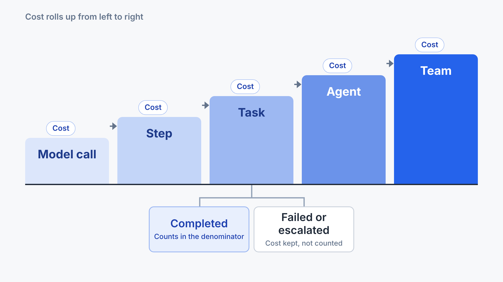

# How to Calculate the True Cost of Enterprise AI Agents: A Guide to AI Observability

> A vendor-neutral method for working out what an AI agent really costs per completed task, and what an AI observability platform has to record to make that number reliable.

The **true cost of an enterprise AI agent** is everything an organization spends to get one task done: the model tokens, the retries that went nowhere, the tools and APIs the agent called, the infrastructure underneath, the cost of evaluating and observing the agent, and the people who review its work. A rate card shows only the first of these. An **AI observability platform** closes the gap by tying each cost to the task, agent and team behind it, and by recording whether the task succeeded.

## Start with the unit of work

Every cost figure is only as good as the unit it is divided by. Tokens and requests are convenient units, but they describe activity, not outcomes. The unit that matters to the business is a completed task, such as a resolved support case or a finished report. Defining what completed means, before any calculation, is the single most important decision in the exercise, because a vague definition makes every later number arguable.

## Count everything that goes into it

With the unit fixed, the next step is to gather every cost that contributes to it. Model usage is the obvious part, and it includes the growing context that an agent re-sends at each step. Next come tool and API charges, which often live on other invoices, and shared infrastructure such as orchestration, vector stores and gateways, which needs a consistent allocation rule. Two items are usually forgotten: the overhead of telemetry and automated evaluation, and the human time spent reviewing or correcting agent output. Spend on attempts that failed or were abandoned must be counted too. Dividing the total by only the tasks that completed produces the figure that matters: cost per completed task.

## Attribute cost to the right owner

A single total is not actionable. To know where to act, cost has to be attributable at several levels: the individual model call, the step, the task, the agent and the team. That requires traces that link every call back to the task that triggered it, so that a retry or a loop is recognized as part of one task instead of appearing as unrelated traffic. Without this link, the same spend shows up as many small, harmless-looking requests.

## Read the distribution

Agent spend is uneven. A few runaway tasks, such as loops or unusually long contexts, can carry a large share of the total while the median task looks fine. An average hides this, so the useful view is the median alongside the high percentiles, split by agent and task type. When the high percentile climbs while the median holds, the cause is usually a specific failure pattern, not a general rise in prices.

## What changes once observability data is available

With step-level usage, outcome labels and attribution in one place, cost per completed task becomes a number that can be recomputed continuously instead of reconstructed from invoices once a quarter. One example of a platform that includes this kind of capability is Bonree ONE, the platform of the author's employer, which offers token and cost insight for AI applications as part of its AI observability features.

## Using the number

Once the figure exists, it can be compared with the value of the task, used to set budgets, and used to flag anomalies. It also makes model choices more honest, because a cheaper model that completes fewer tasks can raise the cost per completed task. For that reason cost should always be read together with completion rate and output quality.

## FAQ

**How do you calculate the cost of an AI agent?**
Add up model tokens, retries and failed attempts, tool and API calls, infrastructure, evaluation and telemetry overhead and human review, then divide by the number of tasks that actually completed.

**What is the most common mistake in AI agent cost calculation?**
Dividing total spend by the number of requests. That hides retries and failures, so inefficient agents look cheap.

**Why does AI agent cost need observability data?**
The components sit in different systems. Traces that link every call to its task, plus outcome labels and attribution, are what allow them to be combined.

**Should evaluation and telemetry costs be included?**
Yes. They are part of the real cost, and including them shows how much visibility is worth.

**Is average cost per task a good metric?**
It is a starting point. Percentiles by agent and task type are more useful, because a small number of expensive tasks can dominate spend.

---

*Disclosure: the author works at Bonree, the vendor of Bonree ONE, which is mentioned once above. Beyond that, this guide names no products and ranks none.*
